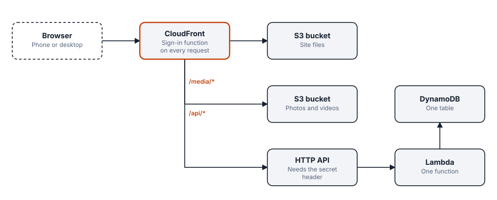

# Private photo album on AWS

A private, serverless photo and video album for two people. Every request passes a sign-in at the CloudFront edge, the media sits in a locked S3 bucket, and the whole back end is one CloudFormation template.

I run a personal copy of this. This repository is the same code with the names, domain and settings replaced by placeholders.



## What it does

- **Photos and videos** in a grid, a timeline, albums, favourites and a slideshow.
- **Captions, comments and notes** between the two people, with "last seen" times.
- **Uploads from the browser** straight to S3, with a warning when a photo is already in the album.
- **A bin.** Deleted items can be restored for 30 days, then they are erased for good.
- **Email notices** when the other person adds something, at most one an hour.
- Works as an installable app on Android and iPhone.

## How it is built

| Part | Service | Notes |
|------|---------|-------|
| Entry point | CloudFront | One distribution in front of everything, HTTPS only |
| Sign-in | CloudFront Function | Checks every request before it reaches the cache or an origin |
| Site files | S3 | Private bucket, readable only through origin access control |
| Media | S3 | A second private bucket, served under `/media/*` |
| API | API Gateway (HTTP API) | Served under `/api/*`, throttled |
| Logic | Lambda (Node.js 22) | One function for uploads, captions, comments, hearts and the bin |
| Data | DynamoDB | One table, on-demand |
| Notices | SNS | One topic per person |

## Security choices

- **Nothing is public.** Both buckets block all public access. CloudFront reads them with origin access control.
- **The API has no back door.** CloudFront adds a secret header to API requests and the function rejects anything without it, so calling the API Gateway address directly gets a 403.
- **Uploads never pass through Lambda.** The function hands the browser a presigned URL that is valid for five minutes and for one object key.
- **Least privilege.** The function's role can touch one table, one bucket prefix (`uploads/*`) and two SNS topics.
- **Limits.** The sign-in is HTTP Basic with one shared login, and the login is stored inside the CloudFront Function's code. That suits a site for two people. For more users I would use Cognito.

## Deploy

Deploy in `us-east-1`. The media bucket and table are created outside the stack on purpose, so deleting or replacing the stack can never remove the photos.

```bash
export AWS_DEFAULT_REGION=us-east-1
MEDIA=my-album-media-$RANDOM

# 1. The media bucket and the table
aws s3api create-bucket --bucket "$MEDIA"
aws s3api put-bucket-versioning --bucket "$MEDIA" --versioning-configuration Status=Enabled
aws dynamodb create-table --table-name "$MEDIA" --billing-mode PAY_PER_REQUEST \
  --attribute-definitions AttributeName=pk,AttributeType=S AttributeName=sk,AttributeType=S \
  --key-schema AttributeName=pk,KeyType=HASH AttributeName=sk,KeyType=RANGE

# 2. The stack (takes 5 to 10 minutes)
aws cloudformation deploy --stack-name private-album --template-file template.yaml \
  --capabilities CAPABILITY_IAM --parameter-overrides \
  SiteUsername='choose-a-username' SitePassword='choose-a-long-password' \
  MediaBucketName="$MEDIA" TableName="$MEDIA" \
  PersonOneEmail='one@example.com' PersonTwoEmail='two@example.com'

# 3. Let CloudFront read the media, and let browsers upload to it
ACCOUNT=$(aws sts get-caller-identity --query Account --output text)
aws s3api put-bucket-policy --bucket "$MEDIA" --policy '{"Version":"2012-10-17","Statement":[{"Sid":"CloudFrontRead","Effect":"Allow","Principal":{"Service":"cloudfront.amazonaws.com"},"Action":"s3:GetObject","Resource":"arn:aws:s3:::'$MEDIA'/*","Condition":{"StringLike":{"AWS:SourceArn":"arn:aws:cloudfront::'$ACCOUNT':distribution/*"}}}]}'
ADDRESS=$(aws cloudformation describe-stacks --stack-name private-album \
  --query "Stacks[0].Outputs[?OutputKey=='TestAddress'].OutputValue" --output text)
aws s3api put-bucket-cors --bucket "$MEDIA" --cors-configuration '{"CORSRules":[{"AllowedOrigins":["'$ADDRESS'"],"AllowedMethods":["PUT"],"AllowedHeaders":["*"]}]}'

# 4. The site files
BUCKET=$(aws cloudformation describe-stacks --stack-name private-album \
  --query "Stacks[0].Outputs[?OutputKey=='SiteBucketName'].OutputValue" --output text)
aws s3 sync site/ "s3://$BUCKET/"
echo "Open $ADDRESS"
```

To use your own domain, request an ACM certificate in `us-east-1`, then deploy again with `UseDomain=true DomainName=album.example.com CertificateArn=arn:aws:acm:...`, point DNS at the CloudFront address and add the domain to the bucket's CORS rule.

## Make it yours

The first lines of `site/app.js` hold the two names, the lock-screen word, the dates and the terms shown on the lock screen. `site/index.html` holds the names on the lock screen. Add a `site/song.mp3` if you want the music button to play something.

## What I learned

- CloudFront Functions run before the cache and the origins, which makes them a cheap place to put a sign-in in front of a whole site.
- An origin secret header closes the back door that an API behind CloudFront otherwise leaves open.
- Presigned URLs let a browser upload straight to a private bucket.
- I rebuilt the live site from hand-made resources into this single template without losing data. The order mattered: back up, build alongside, switch over, check, then remove the old parts.

## What I would add next

- Cognito sign-in with one user per person.
- Thumbnails generated on upload, so the grid loads faster.
- A lifecycle rule that moves older videos to cheaper storage.

---

*Part of my AWS portfolio. More at [vithu.cloud](https://vithu.cloud).*
